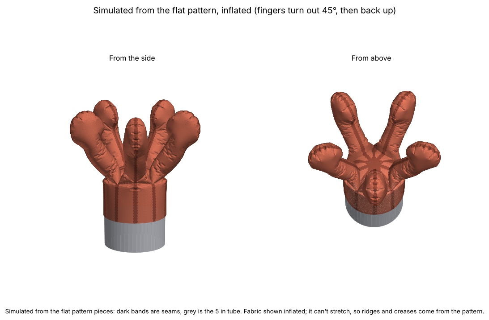
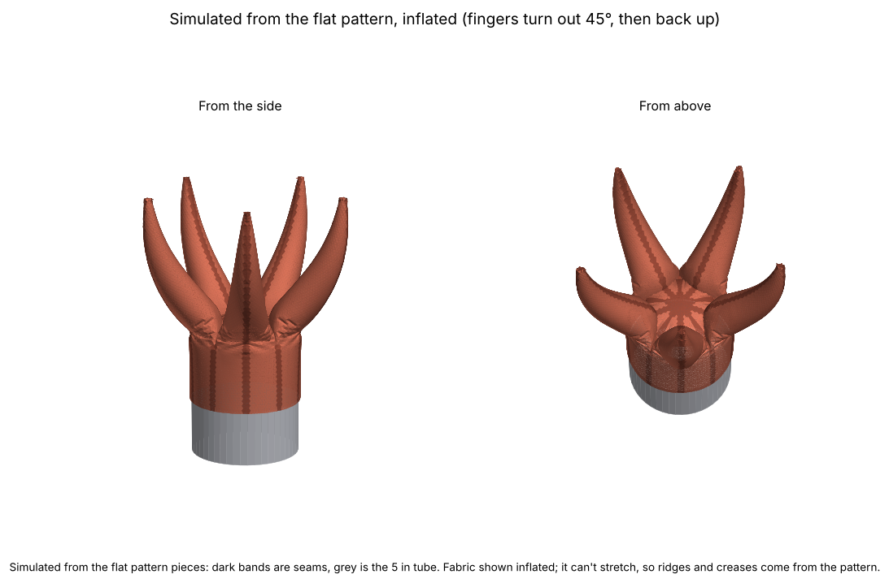

# Coral polyp sewing pattern

A fabric coral polyp made of **five fingers** around a round "wrist" (cuff) that slides over the end of a **5 in tube**. It works like an **inflatable costume**: air pressure fills it out.

Each finger is two mirror-image halves, so the seam runs from the centre of the top, out over the fingertip, and down the cuff. There's one pattern piece, and you cut 10 of it (5 pairs). The fingers **lean outward just above the cuff, then curve back up to vertical** at the tips. They narrow above the crotch to a skinnier middle, and the rounded end keeps the width of the earlier, wider fingers.

| Club tip (`polyp-5-club`) | Tapered point (`polyp-5-taper`) |
|---|---|
|  |  |

## Designs

Every file is in `designs/`, and its name starts with the design name, so a pattern and its pictures always match:
- `<design>-pattern.pdf`: the pattern to print
- `<design>-3d.png`: the simulated, inflated polyp
- `<design>-piece.png`: a quick picture of the flat piece

| Design | What it is | How to make it |
|---|---|---|
| `polyp-5-club` | **Main design.** 5 fingers, 7.5 in long. Each finger narrows to a skinnier middle, and the rounded end is as wide as `polyp-5-wide`'s. | `python3 make_pattern.py --out designs --name polyp-5-club` |
| `polyp-5-taper` | 5 fingers, 8.5 in long. Each finger starts at the full crotch width, like the earlier versions, and tapers all the way to a **sharp point**, like a horn. | `POLYP="TAPER=1,FINGER_LENGTH=8.5" python3 make_pattern.py --out designs --name polyp-5-taper` |
| `polyp-5-club-pointed` | Like the club, but 8.5 in long, with a rounded point on the end. | `POLYP="FINGER_LENGTH=8.5,TIP_LENGTH=2.8,TIP_POINT=1" ...` (made with an earlier version of the script) |
| `polyp-5-wide` | 5 fingers at an even width, 6 in long. | earlier version of the script |
| `polyp-6` | 6 fingers, 6 in long, lean out and curve back up. | earlier version of the script |
| `polyp-6-outward-4in` | 6 fingers, 4 in long, straight at the base and curving outward. | commit `e02c3d8` |

Patterns longer than one page are split over 2 landscape pages. Trim the later page on its dashed tape line, lay it over the earlier page so the lines and diamonds match, and tape. Print at **100 % / "Actual size"** and check the 1 in test square.

## Scripts

- **make_pattern.py**: draws the pattern. The settings are at the top. Options:
  - `--out folder` sets where the files go.
  - `--name design` sets the start of every file name.
  - `--no-sim` skips the 3D simulation.
  - To override settings without editing the file, put them in `POLYP`, for example `POLYP="FINGERS=6,FINGER_LENGTH=8"`.
- **sim_polyp.py**: the cloth simulation behind the `-3d.png` pictures.

The scripts need `numpy`, `scipy`, `matplotlib` and `shapely` (`pip3 install numpy scipy matplotlib shapely`).

## Sizes and settings

| Setting | Value | Meaning |
|---|---|---|
| `TUBE_DIAMETER` | 5.0 in | the tube (15.71 in around) |
| `EASE` | 0.5 in | extra room in the cuff so it slides on (woven fabric). Use about -0.5 for stretchy fabric. |
| `FINGERS` | 5 | number of fingers |
| `CUFF_HEIGHT` | 3.0 in | finished height of the wrist |
| `FINGER_LENGTH` | 7.5 in | finger length on the flat piece, from crotch to tip |
| `BODY_WIDTH` | 2.6 in | flat width of the finger's middle (about 1.65 in across sewn) |
| `TIP_WIDTH` | 3.59 in | flat width of the rounded end (about 2.3 in across sewn), the same as the earlier 5-finger version |
| `TIP_LENGTH` | 2.06 in | length of the rounded end |
| `TIP_POINT` | 0.5 | end shape: 0.5 is round, 1.0 is pointed |
| `TAPER` | 0 | 1 = ignore the three width settings above. The finger starts at full crotch width and tapers to a sharp point. |
| `TAPER_FULLNESS` | 0.6 | with `TAPER`: 0 gives straight cone sides, and higher values give a fuller shape before the point |
| `SPLAY` | 45° | how far the fingers lean out just above the crotch |
| `TURN_LENGTH` | 1.5 in | the distance over which they turn outward. Above that, they curve back to vertical. |
| `SEAM` | 3/8 in | seam allowance, already added to every edge |
| `HEM` | 1.0 in | extra at the bottom of the cuff for the hem |

The cuff comes out 16.21 in around. At the crotch (where a finger starts), each piece is 3.24 in wide, because five fingers have to fill the cuff's circumference. Over the first 1.5 in, the finger narrows to `BODY_WIDTH`. Over the last 1.5 in before the rounded end, it widens back out to `TIP_WIDTH`. The cut piece is about 5.9 × 11.5 in.

## How to sew it

Sew with the right (good) sides of the fabric facing each other, on the dashed line, 3/8 in in from the edge.

- **Cut 10.** Fold the fabric in half, right sides together, and cut 5. Each cut gives a mirror-image pair: the two halves of one finger.
- **Notches** (small triangles on the edges) mark the crotch. Snip no deeper than 1/4 in.
- **Slash to the dot.** The piece has a narrow V coming in from the cuff end. The seam allowances fill the point of the V, so the cut line stops short. Cut along the solid line up to the dot, and stop right at the dot. The dot is the crotch.

1. **Make the fingers.** Pin a pair together. Sew one continuous seam: from the bottom of the cuff strip, along the outer edge, around the tip, back along the inner edge, and down the straight edge of the triangle to its point. Clip into the seam allowance around the curves. Do this 5 times.
2. **Join the fingers.** The V edges of neighbouring halves are the seams between fingers. Sew the cuff edges from the dot to the bottom edge, then the triangle edges from the dot to the point. Go around until all 5 are joined.
3. **Check the middle.** All 10 triangle points meet at the centre of the top. Hand-stitch any small hole closed.
4. **Hem.** Fold the bottom edge up 1/4 in, then up 3/4 in, and stitch.
5. **Turn it right side out** through the wrist and push the fingers out.

## How the pattern shapes the fingers

- **Width.** The flat piece is half the finger's circumference, so a sewn finger is about (2 × flat width) / π across.
- **Curve.** A finger curves when one of its sewn edges is longer than the other. The seam runs in the same plane as the curve.
  - If the inner edge (the side facing the centre of the polyp) is longer, the finger turns outward.
  - If the outer edge is longer, it turns back in.
  - Near the crotch, the inner edge is made longer, so the finger turns out by `SPLAY` over `TURN_LENGTH`.
  - Above that, the outer edge is longer, so the finger eases back to vertical by the tip.
  - To bend the sewn finger by an angle *a*, the flat piece is bent by 2*a*/π. `bend()` in `make_pattern.py` does this along the finger, following `_bend_angle()`.
  - There's a limit. If the turn is too sharp for the finger's width, the outer edge of the flat piece folds over itself. A 45° turn over 1.5 in is safely inside that limit.

## How the 3D picture is made (sim_polyp.py)

This works from the actual pattern piece, not from a drawing of the finished shape:

It simulates **one finger** (its two halves) and copies it around the polyp. The finger's side edges are held on the planes where its neighbours would be sewn on, so it behaves as if they were there. A run takes about a minute.

1. It fills each of the flat pieces with small triangles, about 1/8 in across.
2. It stitches matching seam edges together point by point.
3. It finds the resting shape by minimising energy (scipy L-BFGS):
   - fabric can't stretch, but bunches easily
   - the inside pressure fills it out, as in an inflatable
   - the tube pushes back from inside
   - the hem stays at the bottom of the tube
   - each piece has a little stiffness of its own, and there's none across seams, so ridges and curvature breaks form at the seams

What it leaves out: gravity, fabric thickness, seam-allowance bulk, the inflation air inlet, and the fingers pushing on each other.

**Finding: the inflated fingers can sit two ways, spread out or bunched up.**
- If the simulation starts from straight fingers, it gets stuck with them bunched upright.
- If it starts from the curve the pattern intends, it settles into the spread shape shown above.
- The spread shape holds more air (151 vs 149 cubic in), so inflation favours it.
- In real life, the fingers might need a nudge or a shake while inflating to pop into place.
- To make it reliable, you could add internal ties or a stiffener at the base of each finger.
- The simulation starts from the intended curve, and the `-3d.png` pictures show that result.

**Other results (quick, coarser runs):**
- The 7.5 in fingers stand about 6.1 in tall once inflated, and the tips reach about 4.3 in out from the centre.
- `polyp-5-club-pointed`'s 8.5 in fingers stand about 6.5 in tall, and the tips reach about 4.7 in out.
- The wider end reads as a gentle club shape.
- Inflated, the pointed end comes out as a blunt, slightly crumpled point. Air pressure rounds a sharp point off.

## History

- First design: version A (outer + inner halves) and version B (left + right halves). Remy chose B, and A was removed. It's still in the git history.
- Next: B with fingers curving outward from vertical (`polyp-6-outward-4in`).
- A try at a narrow neck with a bulb near the tip was dropped at Remy's request.
- Next: fingers lean out at the base and curve back to vertical, and they're longer, 6 in (`polyp-6`).
- Remy preferred 5 fingers (`polyp-5-wide`).
- Then: 5 fingers, skinnier and longer (7.5 in), with the end kept the same size (`polyp-5-club`), plus a longer version with a rounded point (`polyp-5-club-pointed`).
- Now: added `polyp-5-taper`, with fingers that taper to a real point. Files are now named by design.
