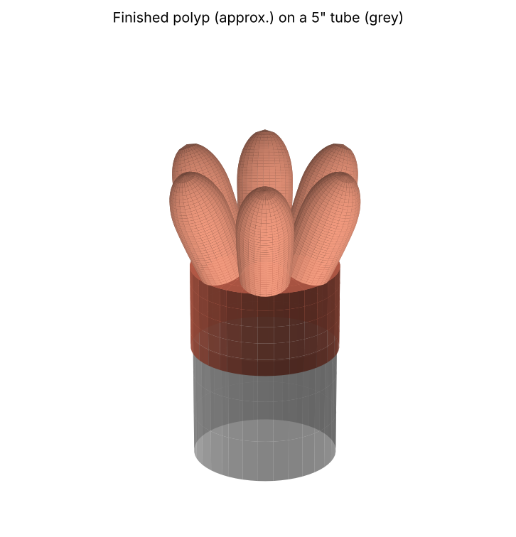

# Coral polyp sewing pattern

A fabric polyp shaped like six glove thumbs joined at the base. The bottom is a round "wrist" (cuff) that slides over the end of a **5 in tube**.

## Files

- **pattern.pdf**: the pattern pieces at true size, one per page. Print at **100 % / "Actual size"** (not "Fit to page") and check the 1 in test square with a ruler.
- **pattern-preview.png**: both pieces side by side, for a quick look.
- **polyp-preview.png**: what the sewn polyp looks like on the tube (approximate).
- **make_pattern.py**: the script that draws everything. Change the numbers at the top and run `python3 make_pattern.py` to remake the files.

## The sizes

| | Finished size |
|---|---|
| Tube | 5 in across (15.71 in around) |
| Cuff (wrist) | 16.21 in around, so 0.5 in of ease to slide on, and 3 in tall |
| Thumbs | 6 of them, 4 in tall, about 1.7 in across at the base and 1.9 in at the widest |
| Seam allowance | **3/8 in**, already added to every edge |
| Hem | 1 in extra at the bottom of the cuff, already added |

Each piece is about 3.8 in wide. Piece A is 8.4 in tall and piece B is 7.5 in tall.

The 0.5 in of ease is for fabric that doesn't stretch. For stretchy fabric (fleece, jersey, spandex), set `EASE = -0.5` so it grips the tube.

## Pieces

- **A, Outer panel (cut 6).** A thumb on top of a strip of cuff. The six cuff strips sew into the round wrist.
- **B, Inner panel (cut 6).** A thumb on top of a triangle. The six triangle points meet in the middle of the top, like the panels on a baseball cap.

The small triangles on the edges of each piece are **notches**. They mark the "crotch", the point where the thumb starts. Snip a tiny cut there (no deeper than 1/4 in) so you can find it on the fabric.

## How to sew it

Sew with the right (good) sides of the fabric facing each other, on the dashed line, 3/8 in in from the edge.

1. **Make the thumbs.** Pin one A to one B along the thumb edge, notch to notch. Sew from one notch, up and over the rounded tip, and down to the other notch. Stop exactly at the notch and backstitch. Do this 6 times. Clip into the seam allowance around the tip so it turns smoothly.
2. **Make the top.** Sew the triangle edge of one B to the triangle edge of the next B, from the notch to the point. Keep going around until all six triangles are joined and the points meet in the middle.
3. **Close the cuff.** Sew the long straight side of each A to the next A, from the notch down to the bottom edge. This closes the wrist into a tube.
4. **Hem.** Fold the bottom edge up 1/4 in, then up another 3/4 in, and stitch it down.
5. **Turn it right side out** through the wrist, and push the thumbs out with a chopstick or pencil eraser.

Steps 2 and 3 meet the thumb seams at the notches. Line all of them up there, so each crotch is a neat point with no hole.

## Changing it

The settings at the top of `make_pattern.py`:

- `TUBE_DIAMETER = 5.0`: the tube size.
- `EASE = 0.5`: extra room so it slides on.
- `THUMBS = 6`: use 5 for five fatter thumbs.
- `CUFF_HEIGHT = 3.0` and `THUMB_LENGTH = 4.0`.
- `THUMB_BULGE = 0.35`: how much the thumbs swell above the base.
- `SEAM = 3/8` and `HEM = 1.0`.
