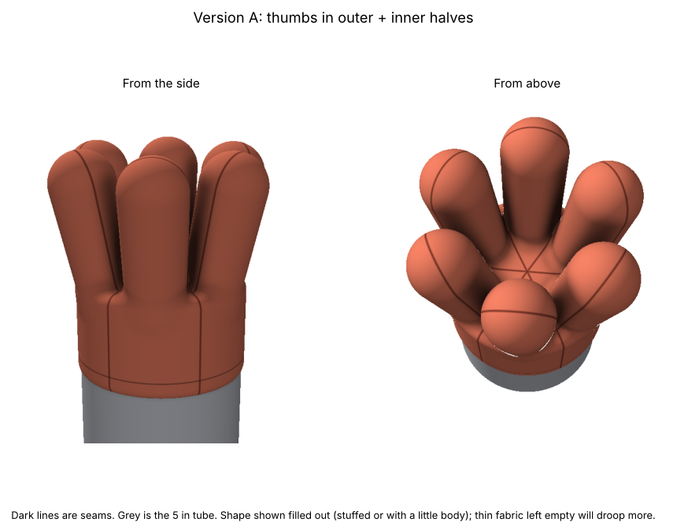
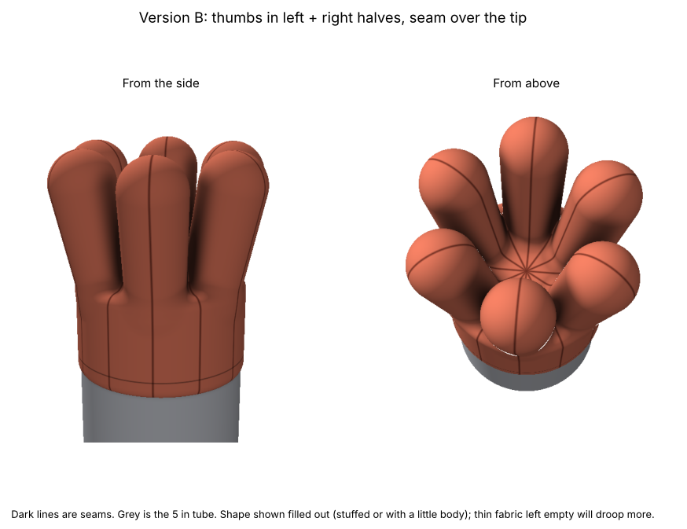

# Coral polyp sewing pattern

A fabric polyp shaped like six glove thumbs joined at the base. The bottom is a round "wrist" (cuff) that slides over the end of a **5 in tube**.

There are two ways to sew it. They look the same when finished. Only the seams are in different places.

| Version A: outer + inner halves | Version B: left + right halves |
|---|---|
|  |  |
| The seam runs up both sides of each thumb. | The seam runs from the centre of the top, out over the tip of the thumb, and down the cuff. |
| 2 pattern pieces, cut 6 of each. | 1 pattern piece, cut 12. |

## Files

- **pattern-version-a.pdf** and **pattern-version-b.pdf**: the pattern pieces at true size, one per page. Print at **100 % / "Actual size"** (not "Fit to page") and check the 1 in test square with a ruler.
- **pattern-preview.png**: all the pieces side by side, for a quick look.
- **polyp-version-a.png** and **polyp-version-b.png**: what the sewn polyp looks like on the tube, with the seams drawn in.
- **make_pattern.py**: the script that draws everything (with **render_polyp.py** for the 3D pictures). Change the numbers at the top of `make_pattern.py` and run `python3 make_pattern.py` to remake the files.

## The sizes (both versions)

| | Finished size |
|---|---|
| Tube | 5 in across (15.71 in around) |
| Cuff (wrist) | 16.21 in around, so 0.5 in of ease to slide on, and 3 in tall |
| Thumbs | 6 of them, 4 in tall, about 1.7 in across at the base and 1.9 in at the widest |
| Seam allowance | **3/8 in**, already added to every edge |
| Hem | 1 in extra at the bottom of the cuff, already added |

Each piece is about 3.8 in wide and 7.5 to 8.4 in tall.

The 0.5 in of ease is for fabric that doesn't stretch. For stretchy fabric (fleece, jersey, spandex), set `EASE = -0.5` so it grips the tube.

The small triangles on the edges of each piece are **notches**. They mark the "crotch", the point where the thumb starts. Snip a tiny cut there (no deeper than 1/4 in) so you can find it on the fabric.

Sew with the right (good) sides of the fabric facing each other, on the dashed line, 3/8 in in from the edge.

## Version A: how to sew it

- **A1, outer half (cut 6):** a thumb on top of a strip of cuff.
- **A2, inner half (cut 6):** a thumb on top of a triangle. The six triangle points meet in the middle of the top, like the panels on a baseball cap.

1. **Make the thumbs.** Pin one A1 to one A2 along the thumb edge, notch to notch. Sew from one notch, up and over the rounded tip, and down to the other notch. Stop exactly at the notch and backstitch. Do this 6 times. Clip into the seam allowance around the tip so it turns smoothly.
2. **Make the top.** Sew the triangle edge of one A2 to the triangle edge of the next A2, from the notch to the point. Keep going around until all six triangles are joined and the points meet in the middle.
3. **Close the cuff.** Sew the long straight side of each A1 to the next A1, from the notch down to the bottom edge. This closes the wrist into a tube.
4. **Hem** and **turn** (see the end).

## Version B: how to sew it

- **B, thumb half (cut 12).** Fold the fabric in half, right sides together, and cut 6. Each cut gives you a pair that are mirror images of each other: one is the left half of a thumb and the other is the right half.

The piece has a narrow V cut up into it from the bottom. The seam allowances fill the top of the V, so the cut line stops short. **Slash** (cut) along the solid line from the bottom of the V up to the dot, and stop right at the dot. The dot is the crotch.

1. **Make the thumbs.** Take a pair and pin them together. Sew one continuous seam: start at the bottom of the cuff strip, go up the long side, over the rounded tip, down the other side, and keep going down the straight edge of the triangle to its point. Do this 6 times. Clip into the seam allowance around the tip so it turns smoothly. Each thumb now has a seam right down its middle, from the wrist, over the tip, to the centre of the top.
2. **Join the thumbs.** Put two thumbs next to each other. The V edges of the touching halves are the seams between them. Sew the cuff edges together from the dot down to the bottom edge. Then sew the triangle edges together from the dot to the point. Go around until all 6 thumbs are joined into a ring.
3. **Check the middle.** All 12 triangle points meet at the centre of the top. If there's a small hole there, stitch it closed by hand.
4. **Hem** and **turn** (below).

## Both versions: finishing

- **Hem.** Fold the bottom edge up 1/4 in, then up another 3/4 in, and stitch it down.
- **Turn it right side out** through the wrist, and push the thumbs out with a chopstick or pencil eraser.

At each crotch several seams meet. Line them up exactly at the notch or dot so each crotch is a neat point with no hole.

The pictures show the polyp filled out (stuffed or with a little body). Thin fabric left empty will droop more.

## Changing it

The settings at the top of `make_pattern.py`:

- `TUBE_DIAMETER = 5.0`: the tube size.
- `EASE = 0.5`: extra room so it slides on.
- `THUMBS = 6`: use 5 for five fatter thumbs.
- `CUFF_HEIGHT = 3.0` and `THUMB_LENGTH = 4.0`.
- `THUMB_BULGE = 0.35`: how much the thumbs swell above the base.
- `SEAM = 3/8` and `HEM = 1.0`.

The script needs `numpy`, `matplotlib` and `shapely` (`pip3 install numpy matplotlib shapely`).
