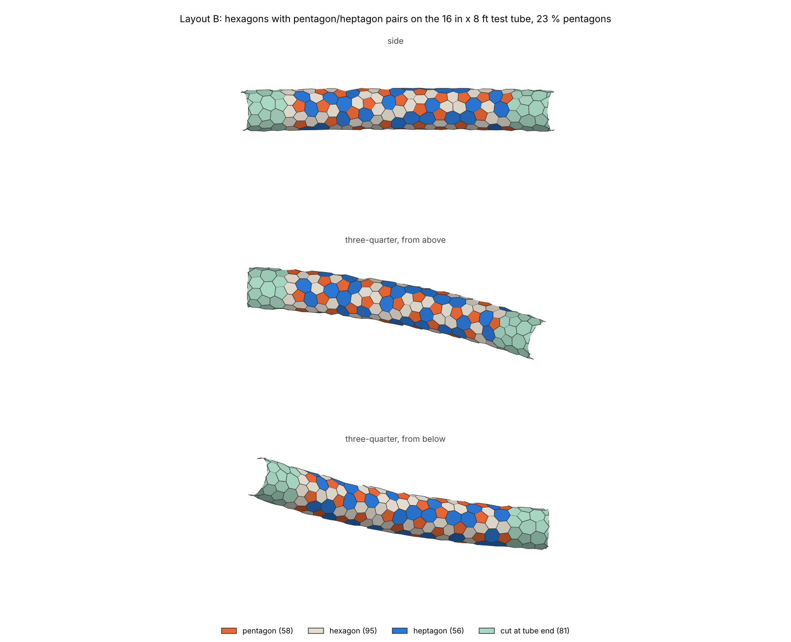

# Layout B: hexagons with pentagon/heptagon pairs ("hex57")

One of three layout experiments for the coral skin. This one starts from a honeycomb and gets its organic look from scattered **pentagon/heptagon pairs** and **graded shape sizes**.

| File | What it is |
|---|---|
| `hex57_layout.py` | The script. Run it with `python3 hex57_layout.py`. It takes about 15 seconds. |
| `layout.json` | The result as plain data: corner points plus a list of polygons. |
| `preview_3d.png` | The skin on the test tube, from three angles. |
| `preview_closeup.png` | A close-up of the middle of the tube. |
| `preview_unrolled.png` | The tube cut open along one side and laid flat. |
| `viewer.html` | **3D viewer.** Double-click it to open it in your web browser, then drag to spin it around. Needs internet the first time (it loads the 3D library). |
| `make_viewer.py`, `viewer_template.html` | Build `viewer.html` from `layout.json`. The main script does this for you. |

Colours: **orange = pentagon**, **sand = hexagon**, **blue = heptagon**, **green = shape cut off by the open tube end**.



## Running it

You need Python 3 with three add-on libraries: numpy (number crunching), scipy (fast nearest-point search) and matplotlib (pictures). Install them once with:

```
pip3 install numpy scipy matplotlib
```

Then, from this folder:

```
python3 hex57_layout.py
```

The script overwrites `layout.json`, the three PNGs and `viewer.html`, then prints the measurements.

## Results with the default settings (seed 7)

| | |
|---|---|
| Shapes | 21 pentagons, 95 hexagons, 18 heptagons, plus 13 cut at the tube ends (147 in total) |
| Size across | min 2.6 in, average 4.7 in, max 7.9 in |
| Out of flat | max 0.74 in, average 0.29 in |
| Corners lifted off the surface by flattening | up to 0.15 in |
| Shortest edge | 1.37 in (0.38 in on the cut end shapes) |
| Pentagons touching each other | 0 |
| Corners | every corner is shared, and exactly 3 panels meet at each one |

"Across" means the diameter of a circle with the same area as the shape. For a regular hexagon that is 5 % more than its flat-to-flat width.

"Out of flat" is, for each panel, how far its furthest corner sits from the flat plane that best fits all of its corners. Panels average about 0.3 in, and the biggest ones (7 to 8 in on a 12.5 in tube) reach about 0.75 in. That is the "playing card on a can" effect from `FUSION-CONTEXT.md`: big shapes on a thin tube can't be flat.

## How it works, in plain language

1. **Test tube.** The script builds a tube 6 ft long and 12.5 in across. It bows gently sideways, narrows to 75 % at the base and 50 % at the tip, and bulges slightly along its length. It then samples about 180,000 points on it, each with its outward direction. From here on, the method only uses those sample points. That is the same kind of data a Fusion mesh or T-spline body would give us.

2. **Size map.** The script scatters a few dozen random "blobs" over the surface and blends them into a smooth, blotchy map. Each spot on the map gets a target shape size between `SIZE_MIN` and `SIZE_MAX`. The mapping is tuned so the average comes out near `SIZE_MEAN`. Where the tube is thinner, shapes are scaled down (`SIZE_FOLLOWS_RADIUS`), so the tapered ends get smaller shapes. The script measures how thin the tube is from how fast the surface curves, not from the tube's formula.

3. **Start from a honeycomb.** The script stores one *seed* point per shape. Each seed is joined to its neighbours with links, and the links form triangles. A shape is the area around its seed, so:
   - a seed with **6 neighbours makes a hexagon**;
   - a seed with **5 neighbours makes a pentagon**;
   - a seed with **7 neighbours makes a heptagon**.

   The script starts with a perfect honeycomb wrapped on the tube: 8 around and 17 rows.

4. **Adapt to the size map.** This repeats 14 times:
   - **Split** any link that is much longer than the size map wants. This adds a shape, which is how a region gets smaller shapes.
   - **Merge** the two seeds of any link that is much shorter than it wants. This removes a shape, which is how a region gets bigger ones.
   - **Swap** a link to its other diagonal when that brings seeds closer to 6 neighbours. Swaps are heavily penalised if they would put two pentagons side by side.
   - **Settle**: the links act like springs of the target length, and the seeds slide over the surface until they balance.

   Where the size changes, a honeycomb can't stay all hexagons. Pentagon/heptagon pairs appear on their own, which is the same thing that happens in real crystals and in graphene. In the result, pentagons sit where shapes get smaller and heptagons where they get bigger.

5. **Scatter a few pairs on purpose.** The script picks a random link between hexagons and turns it a quarter turn. That one move turns two hexagons into pentagons and two into heptagons. It is the same "edge rotation" the Onshape `organicLayout` used. A pair is only placed where the surrounding shapes are plain hexagons, so pairs don't touch.

6. **Seeds to shapes.** Each triangle of seeds becomes one **corner**, so every corner is shared by exactly the three shapes that meet there. Shapes at the open ends also get corners on the rim. Then the corners are **relaxed**: each shape is gently pulled towards a regular polygon of its target size, and every corner settles where its three shapes agree. That relaxing is what gives the "geometric" half of the look.

7. **Slight flattening (optional).** Corners may lift up to 0.15 in off the surface so that each panel gets a little flatter.

8. **Measure, save, draw.**

### Where it relies on the tube's "around × along" structure

Only in three places, all marked `TUBE-SPECIFIC` in the code:

- **`TestTube`** makes the test surface.
- **`start_honeycomb`** lays the first honeycomb in rows around the tube. On another surface, you could start from any rough triangle mesh of it instead, such as Fusion's own mesh of a body. Step 4 rebuilds the pattern anyway.
- **The unrolled picture** needs to know where to cut the tube open.

Everything else (projecting points onto the surface, the size map, measuring curvature, split/merge/swap/settle, corners, relaxing, measuring) works on any surface given as dense points with outward directions. The open ends are given as closed loops of points.

## `layout.json`

All lengths are in inches.

- `vertices`: corner positions `[x, y, z]`. They are shared, so each corner appears once.
- `polygons`: each shape as a list of corner numbers, going anticlockwise as seen from outside the tube.
- `polygon_info`: for each shape, its number of sides, whether it is cut by a tube end (`end`), area, across, flatness, centre and outward normal.
- `vertex_shapes`: for each corner, the shapes that meet there. Use it later to put 1.5 in holes at corners where 3 or more shapes meet.
- `vertex_on_rim`: whether the corner lies on an open end of the tube.
- `vertex_unrolled`: the corner's position in the unrolled view.
- `params`, `metrics`: the settings used and the numbers printed by the script.

That's what the hole step needs later: a shared corner list for the corner holes, a polygon list with centres and normals for the centre holes and cutouts, and side counts to tell pentagons from connecting shapes.

## Settings you can change (top of the script)

| Setting | Default | What it does |
|---|---|---|
| `SEED` | 7 | Change it for a different random layout with the same character. |
| `SIZE_MIN`, `SIZE_MAX` | 3, 7 | Range of shape sizes, in inches across. |
| `SIZE_MEAN` | 5 | Target average size. The real average comes out a bit lower (4.7) because the thin ends get smaller shapes. |
| `SIZE_PATCH` | 12 | How big the patches of similar size are. Smaller gives a busier mix with more pentagon/heptagon pairs; bigger gives smoother grading and more plain honeycomb. |
| `SIZE_FOLLOWS_RADIUS` | 0.7 | How much shapes shrink where the tube is thinner (0 = not at all, 1 = fully in proportion). |
| `EXTRA_PAIRS` | 4 | Pairs added on purpose, on top of the ones size grading creates. |
| `SIZE_PULL` | 0.5 | How strongly each shape is pulled to its target size while relaxing. Without it, heptagons come out large and pentagons small. |
| `CORNER_RELAX_ROUNDS`, `CORNER_RELAX_STRENGTH` | 40, 0.5 | How much shapes are evened out towards regular polygons. Fewer rounds or less strength looks more organic. |
| `FLATTEN_ROUNDS`, `FLATTEN_MAX_OFFSET` | 20, 0.15 in | Let corners lift off the surface to make panels flatter. Set `FLATTEN_ROUNDS = 0` to turn it off. |
| `TOUCH_PENALTY_55`, `TOUCH_PENALTY_77` | 4, 2 | How strongly two pentagons, or two heptagons, are kept from sharing an edge. |
| `TUBE_*`, `BASE_TAPER`, `TIP_TAPER`, `BEND` | | The shape of the test tube. |

## Pros and cons

**Pros**
- It reads as a honeycomb with "mistakes" in it: mostly hexagons, with scattered pentagons and heptagons and clearly different sizes from place to place.
- Exactly 3 panels meet at every corner. That is the gentlest corner for folding 1 mm plastic, and it means every corner gets the same kind of hole later.
- Pentagons never touch each other.
- Sizes are only settings, so a thicker branch simply gets more shapes around it.
- Nothing is forced. Shapes take whatever size the surface allows, so there is no over-stretching like the 7 in / 50 % Onshape run.

**Cons**
- Pentagons are not the "hero" shapes here. They come out a bit smaller than average (they sit where shapes get smaller), and heptagons come out bigger. If big pentagons are still wanted, Layout B is the wrong family.
- Big shapes on a 12.5 in tube bow up to about 0.75 in. That's fine if the plastic is allowed to bend; otherwise lower `SIZE_MAX` on thin branches.
- Sizes overshoot the range a little (2.6 to 7.9 in for a 3 to 7 in target), because heptagons grow and pentagons shrink.
- Shapes cut by the open tube ends can have short edges (down to about 0.4 in). They'll need their own treatment once we decide how branch ends finish.
- It isn't a perfect "corners on the surface" pattern, because flattening lifts corners up to 0.15 in. Turn flattening off if that matters.

## What I'd change next

1. **Closed tips and forks.** Test on a closed rounded tip, which needs about 6 extra pentagons, and on a Y-shaped fork, which needs heptagons. The method should handle both without changes, because swap/split/merge doesn't care about the shape. It only needs a sampled surface.
2. **Read a real surface from Fusion.** Export the branch as a mesh (OBJ or STL), load its points and normals in place of `TestTube.dense_sample()`, and use its open edge loops as the rims.
3. **Size map from a drawing.** Instead of random blobs, let Remy paint where big and small shapes go, for example big on the trunk and small near the tips.
4. **Holes and cutouts.** The data already has what's needed: shared corners, valence per corner, and centres and normals per shape.
5. **Flat pieces for the CNC.** Group neighbouring shapes into strips that fit 48 × 96 in sheets.


## Update: 8 ft bent cylinder and pentagon coverage slider

- The test shape is now a plain 12 in cylinder, 8 ft long, with its centreline bent on a 20 ft radius (`TUBE_LENGTH`, `TUBE_RADIUS`, `BEND_RADIUS` at the top of the script). No taper or bulge.
- `PENTAGON_COVERAGE` (default 0.35) is the share of the skin's area covered by pentagons. The script adds pentagon/heptagon pairs until it gets there, and never lets two pentagons share an edge. When there is no room for more pentagons it makes them bigger (up to `PENT_SCALE_MAX`) instead.
- The script also writes layouts at 15, 20, 25, 30, 35 and 40 % into `coverage/`, and `viewer.html` has a slider across them. On this tube about 28 % is the most that fits at the normal pentagon size. 35 % needs pentagons about 1.75 times the size map's size, and 40 % gets squeezed neighbours with edges under 0.2 in, so 40 % is the practical limit.
- The numbers in the older sections above (tapered 6 ft tube, 147 shapes) describe the first version.


## Update: round shapes on a 16 in tube

Remy asked for roundness first: every corner of a shape about the same distance from the shape's centre. The tube is now 16 in across, 8 ft long, bent on a 20 ft radius.

- **Equal sides.** Every shape is aimed at a regular polygon with sides of the same length: `EDGE` (3.0 in) for hexagons and heptagons, `EDGE * PENT_SIDE_RATIO` (3.45 in) for pentagons. Neighbouring shapes agree on each shared edge length, which is what lets strips unroll without stretching. The seed layout uses the same numbers, so the pattern isn't fighting the corner solver.
- **How round.** For every shape the script measures (farthest corner minus nearest corner) divided by the average corner distance. On the 8 ft this averages about 0.14 and is at most 0.35 (it was 0.49 on average before the change). Pentagons are nearly regular (longest side at most 1.08 times the shortest), and the other shapes' longest side averages 1.5 times the shortest.
- **Pattern runs past the 8 ft.** `TUBE_EXTRA` (15 in) of extra tube on each end; those shapes are greyed and not counted.
- **Trade-offs.** Round shapes, flat cells and many pentagons pull against each other:
  - Flat: corners may lift up to `FLATTEN_MAX_OFFSET` (0.4 in) off the tube. Cells are about 0.27 in out of flat on average and 0.6 in at worst. Smaller cells (lower `EDGE`) are flatter.
  - Coverage: pentagons can't touch, and the shapes around them must stay round, so this tube reaches about 24 % pentagons. More means bigger pentagons (`PENT_SIDE_RATIO`) and less round neighbours (1.3 gets about 26 %).
  - Holes: the biggest round hole that leaves 0.5 in of plastic in a pentagon this size is 3.75 in (`HOLE_DIAMETER`). A 5 in hole needs pentagons 6.45 in across.
