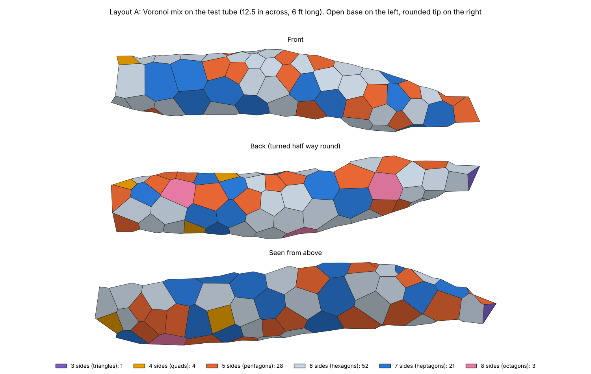
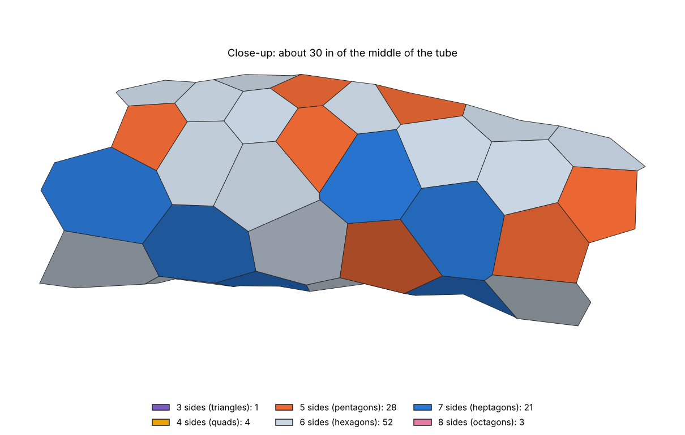
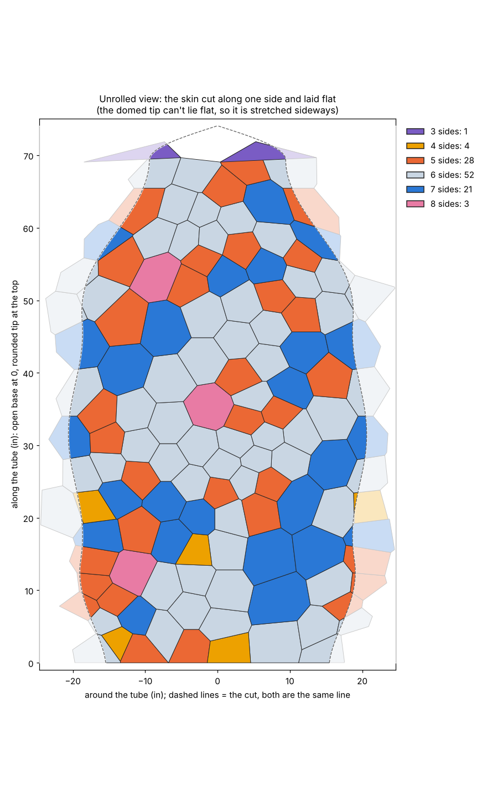

# Layout A: Voronoi mix

A skin pattern made the way nature makes a giraffe's spots or a dragonfly wing.
You scatter "seed" points over the surface, and every spot on the surface
belongs to whichever seed is closest. The patches that come out are called
**Voronoi cells**. They are mostly hexagons, with pentagons and heptagons
scattered among them, and they come in a range of sizes.



| Close-up | Unrolled (cut along one side, laid flat) |
|---|---|
|  |  |

Colours show the number of sides: pale = hexagon, orange = pentagon,
blue = heptagon, pink = octagon, yellow = 4 sides, purple = triangle.

## Results on the test tube (default settings)

The test tube is 12.5 in across and 6 ft long, gently curving, with an open
tapered base and a rounded closed tip.

| | |
|---|---|
| Shapes | 109 (216 shared corners, 324 edges) |
| Hexagons | 52 (48 %) |
| Pentagons | 28 (26 %) |
| Heptagons | 21 (19 %) |
| Others | 4 quads, 3 octagons, 1 triangle at the very tip |
| Size across | min 3.5 in, average 5.0 in, max 6.9 in |
| Out of flat | average 0.37 in, worst 0.87 in |
| Check | every edge is shared by exactly two shapes (one on the open rim) |

"Size across" is the width of a regular hexagon with the same area, measured
flat side to flat side. "Out of flat" is how far the worst corner of a shape
sits from the flat plane that fits the shape best. The biggest shapes on the
thinnest parts of the tube bow the most. That's a tube property, not a
layout property: a 7 in shape on a 12.5 in tube is like a playing card on a can.

## How it works, step by step

1. **Surface as a mesh.** The test tube is built as a fine triangle mesh,
   with triangles about 0.2 in across. Everything after this step uses only
   the mesh, so any mesh (an STL or OBJ exported from Fusion, a T-spline
   body meshed in Fusion) can be swapped in for the test tube.
2. **Size map.** A smooth random field says how big shapes should be in each
   area, from `SIZE_MIN` to `SIZE_MAX`. It gives big-shape and small-shape
   zones that drift across the surface, instead of random sizes next to each
   other.
3. **Seeds by Poisson-disk sampling.** Random points are thrown at the
   surface one by one. A point is kept only if it is far enough from every
   point already kept, where "far enough" follows the size map. The result
   is even, never a grid. The script works out how many seeds fit, then tunes
   the spacing to place that many.
4. **Lloyd relaxation.** Each seed moves to the middle of its own patch, and
   this is repeated `LLOYD_ROUNDS` times. This evens out lopsided shapes. The
   middle is weighted by the size map, so small-shape zones stay small.
5. **Cells and shared corners.** Every mesh point is given to its nearest
   seed. Wherever three patches meet, the script places a corner on the
   surface at exactly the same distance from all three seeds. Each corner is
   stored **once**, and the shapes list it by number, so neighbouring shapes
   share it exactly.
6. **Self-tuning.** Small shapes outnumber big ones, so the plain size map
   gives an average below the middle of the range. The script reruns steps
   2 to 5 a few times with a nudged size map until the average is `SIZE_AVG`.

It takes about 6 seconds.

## Run it

```
pip install numpy scipy matplotlib
python3 voronoi_layout.py
```

It prints the metrics and rewrites `layout.json` and the three pictures.

## Settings you can change (top of `voronoi_layout.py`)

| Setting | Default | What it does |
|---|---|---|
| `SIZE_MIN`, `SIZE_MAX` | 3, 7 in | Smallest and biggest shapes. |
| `SIZE_AVG` | 5 in | Average shape size. The script tunes itself to hit it. |
| `SIZE_WAVELENGTH` | 22 in | How big the "big shape" and "small shape" zones are. Smaller = sizes change faster. |
| `LLOYD_ROUNDS` | 4 | 0 = raw and wild; 4 = organic; 12+ = calmer, rounder, more even shapes. It barely changes the counts of pentagons and heptagons, because the size changes are what create those. To get more hexagons, narrow the size range. |
| `RANDOM_SEED` | 7 | Any other number gives a fresh pattern with the same rules. |
| `TUBE_*`, `BASE_DIAMETER`, `TIP_DIAMETER` | | The test tube only. |
| `MESH_STEP` | 0.2 in | Mesh resolution. Smaller is more exact and slower. |

## What's in `layout.json`

All lengths are in inches.

- `vertices`: the shared corners, as `[x, y, z]`.
- `polygons`: each shape as a list of vertex numbers, in counter-clockwise
  order when seen from outside.
- `vertex_polygons`: for each corner, the shapes that meet there. This is
  ready for the 1.5 in corner holes later.
- `edges`: each edge with its two shapes. This is ready for score/fold lines
  and seams.
- `polygon_info`: number of sides, area, size across, out-of-flat and seed
  point for each shape. This is ready for the centre holes and curved-side
  cutouts later.
- `vertex_on_open_edge`: whether a corner sits on the open rim of the tube.
- `flat_view`: the unrolled 2D outline of each shape (test tube only).
- `metrics` and `parameters`: what's printed, and the settings used.

## Pros and cons

**Pros**
- It looks natural: one consistent "cell" look everywhere, with real size
  variety in soft zones rather than noise.
- It works on any mesh, including domes and, later, forks. Pentagons appear
  on their own where the surface closes up (the tip) and heptagons where it
  would spread (fork crotches). Nothing about the tube's "around × along"
  direction is used.
- Corners are shared by construction, and the script checks it.
- It's fast, and every setting is one number.

**Cons**
- You don't choose which shapes are pentagons. About a quarter come out as
  pentagons and a fifth as heptagons, wherever the size changes put them.
  Pentagons sometimes touch each other. If pentagons need to be a special,
  separated "main panel" again, Layout A isn't the right tool on its own.
- A few odd shapes appear: about 4 % quads, an occasional octagon, and a
  triangle at the very tip.
- Shapes of 6 to 7 in on a 12.5 in tube bow by up to about 0.9 in. Plastic
  1 mm thick can take that, but it's at the edge.
- The open base is cut straight across the cells, so the shapes on that rim
  are partial.

## What I'd change next

1. **Scale sizes to branch thickness.** Make shapes smaller where the branch
   is thin, for example at most about 40 % of the local diameter. That cuts the
   bowing on thin branches and the tip.
2. **Clean up odd shapes.** Merge or split the rare triangles, quads and
   octagons by nudging seeds, so the pattern is only 5, 6 and 7 sides.
3. **Even out corner angles** a little after the cells are built, to get
   the "geometric" half of the look without losing the sizes.
4. **Run it on a real Fusion mesh**, including a fork, by loading an STL in
   place of `make_test_tube()`.
5. Then build the faces in Fusion from `layout.json`, and add the holes and
   cutouts using the corner and polygon lists.
